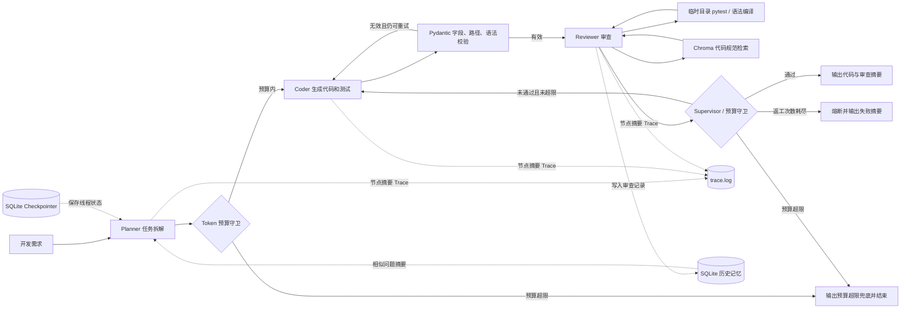

# Multi-Agent Code Review Harness

基于 LangGraph 的多智能体研发协同与代码审查项目。Planner 拆解任务，Coder 生成代码和 pytest 用例，Reviewer 检索代码规范并运行测试。Coder 输出经过 Pydantic 字段、路径和 Python 语法校验；审查未通过或输出不合规时进入有重试上限的 Self-Reflection 闭环。每个工作流默认设置 50,000 Token 预算，并记录各节点的摘要 Trace。

这是可运行的学习与作品集项目。离线 fixture 评测用于验证工作流，不代表真实大模型修复能力。执行器也不是安全沙箱，不能运行来源不明或恶意代码。

## 架构



## 目录结构

```text
agents/       Planner、Coder、Reviewer
core/         LangGraph 状态机、Pydantic 输出模型、Trace、模型配置和记忆
prompts/      三类 Agent 的 Prompt 模板
tools/        Chroma RAG、临时目录测试执行器
data/         示例代码规范
tests/        pytest、五类预置 Bug、自动评测脚本
reports/      Markdown 评测报告
storage/      本地 Chroma 和 SQLite 数据
app.py        命令行入口
trace.log     本地 JSONL 节点摘要日志（已加入 Git 忽略）
```

## 安装

需要 Python 3.10 或更新版本。

```powershell
py -3.10 -m venv .venv
.\.venv\Scripts\Activate.ps1
python -m pip install --upgrade pip
pip install -r requirements.txt
Copy-Item .env.example .env
```

编辑 `.env`：

```dotenv
OPENAI_API_KEY=你的API密钥
OPENAI_BASE_URL=https://兼容服务地址/v1
OPENAI_MODEL=模型名称
MAX_RETRIES=3
CODE_RUN_TIMEOUT_SECONDS=15
```

模型服务应兼容 OpenAI Chat Completions。服务端不返回 Token usage 时，项目不会估算 Token 消耗。

每个工作流默认预算为 50,000 Token。预算在 Planner、Coder 或 Reviewer 返回后检查；达到或超过预算时停止后续节点并输出“预算超限”提示。正在执行的单次 API 请求无法从客户端中途撤销，因此该请求返回后触发熔断。

## 运行 Agent

```powershell
python app.py --task "修复 CSV 汇总函数的空值处理，并补充 pytest 测试"
```

同一个 `--thread-id` 会从 SQLite checkpoint 恢复该线程状态；更换 ID 会建立新线程。审查摘要和问题会写入 SQLite 长期记忆库，后续任务可检索相似记录。

## 测试与评测

```powershell
pytest -q
python -m tests.evaluate --mode fixture
```

fixture 模式不需要 API Key，实际运行 pytest，但 Planner/Coder/Reviewer 响应是预置的，只验证图路由、工具和报告生成。报告会标注此限制，Token 用量为 N/A。

配置 `.env` 后，可运行真实模型评测：

```powershell
python -m tests.evaluate --mode live
```

报告写入 `reports/evaluation.md`，记录任务成功率、平均重试次数、单工作流预算熔断次数和服务端报告的 Token 总量。live 模式的结果取决于模型、API 和评测环境，需以实际生成的报告为准。

Coder 输出必须是符合 Pydantic 契约的 JSON，包含摘要、文件列表、唯一且安全的相对路径，以及至少一个 pytest 文件。所有 `.py` 文件在交给 Reviewer 前会先通过 `ast.parse` 语法校验；校验错误被作为返工反馈写回状态机。`trace.log` 每个节点追加一行 JSON，包含时间戳、Agent 名称、输入/输出摘要和耗时；日志只记录长度、状态和计数，不写入完整任务文本、代码或密钥。

## 评测用例

内置函数级 Bug 和多文件加权有向图路由用例，覆盖上下界反转、除零分支、整除截断、空白清理、去重顺序、路径平局规则和输入边界。每个用例包含原始实现、验收测试和 fixture 修复实现。`test_bug_cases.py` 会验证错误实现确实失败、修复实现确实通过。

## 执行器安全边界

执行器限制文件路径、扩展名、文件大小、输出长度和运行时间，并在临时目录中启动独立 Python 子进程。pytest 会执行测试代码，因此该执行器不是安全沙箱；超时和临时目录不能限制恶意代码访问系统、创建子进程或消耗资源。生产环境需要容器或虚拟机隔离，以及网络、文件系统、系统调用和资源限制。

## 技术边界

- Chroma 使用本地哈希词项向量作为轻量检索基线；它不等同于语义 Embedding，适合演示检索链路，实际项目应替换为经过评估的向量模型。
- 代码规范检索为审查提供参考，测试结果和确定性准出门槛优先于模型意见。
- 长期记忆使用 SQLite 词项重合度检索，面向演示；规模化场景应设计权限、数据保留和更强的检索评估。
- 项目不声称预置用例之外的真实修复成功率。
